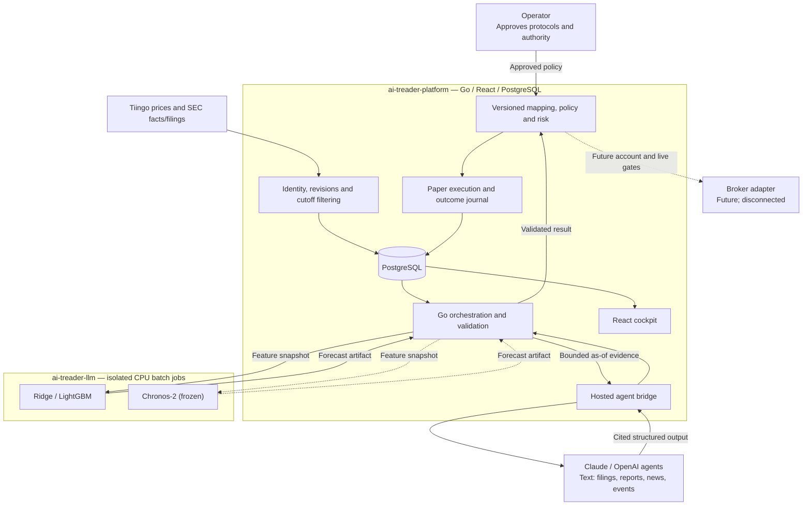
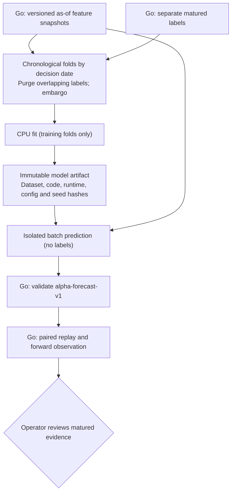

# AI-Treader architecture

Architecture and delivery snapshot — **2026-10-27** (CLEAN02).

A local, personal research and trading system that turns traceable evidence into
recommendations, measures them in paper trading, and may later operate within separately
approved live limits. No broker is connected and no live trading is authorized.

**The model split.** Prediction runs on **CPU numeric models** (ridge, LightGBM, then
Chronos-2 on CPU). Reading text — filings, company reports, news and market events — goes
to **hosted Claude/OpenAI agents**. Go pre-selects the evidence, and agents return cited,
structured features. Those features enter the numeric models only through a measured
ablation. There is no GPU and no local LLM: the Qwen/llama.cpp path and its L03 experiment
were retired on 2026-10-27.

This document is a picture, not a backlog. Task state and order live in the
[LLM backlog](tasks/BACKLOG.csv) and [platform backlog](../ai-treader-platform/tasks/BACKLOG.csv).

## 1. What does what

| Component | Responsibility | Runs where | State |
|---|---|---|---|
| React cockpit | Recommendations, evidence, operations, outcomes | Platform UI | Delivered; numeric views not built |
| Go backend | Ingest, as-of selection, features, orchestration, validation, policy/risk | Platform | Delivered; numeric import and replay delivered (ALPHA04–05) |
| PostgreSQL | Identities, revisions, datasets, runs, decisions, paper ledger, outcomes | Platform | Delivered |
| Hosted agent bridge | Listing analysis, declarative proposals, reviewed text attributes, as-of summaries | Platform CLI adapters; provider inference | AGENT01–06 delivered; no forward protocol frozen |
| Ridge / LightGBM | Relative-return scores | Isolated CPU batch job (target host) | ALPHA02 delivered; frozen 1m/3m pins |
| Chronos-2 | Pretrained time-series challenger | Isolated CPU batch job | LLM ALPHA03 / platform XLLM04 (frozen) |
| Reviewed text attributes | Cited guidance, liquidity and event attributes; accuracy and numeric usefulness | Platform captures; LLM repo evaluation | Workflow delivered; reviewed export absent (TEXT01) |
| Contract validators | Reject malformed, out-of-scope or mismatched results | Python here; Go on the platform | Analysis v2 and numeric v1 conformance delivered |
| Paper engine and journal | Orders, risk, fills, costs, holdings, matured outcomes | Go + PostgreSQL | Delivered |
| Broker adapter | Reconcile and later submit authorized orders | Future Go integration | Not started; separate gates |

## 2. Whole-system view

Models have no broker credentials or database write authority. Go computes financial
values, checks limits and owns execution.

## 3. Numeric learning and prediction

Training and prediction use separate inputs. Supervised fitting needs historical
labels. Prediction jobs and agent prompts never receive them.

Daily features with 1-month and 3-month targets and weekly decisions. Chronos-2 and
reviewed text attributes are separate challengers. Numeric-only is compared with
numeric-plus-text on the same folds and mechanics. A rank is not a probability. A
combined model is considered only after incremental evidence (platform ALPHA08).

## 4. Where we stand

| Capability | Current position | Next / owner |
|---|---|---|
| Data and paper foundation | Identity, revisions, PIT, policy/risk, ledger, journal | Broader historical universe |
| Hosted agents | AGENT01–06; live benchmark below do-nothing | Platform AGENT07 (also gates B00s) |
| Numeric CPU models | Contracts, PIT export, frozen ALPHA03, ridge/LightGBM pins, 2025 retrospective read once | Platform ALPHA09 forward run |
| Chronos-2 (CPU) | Frozen challenger | LLM ALPHA03 → platform XLLM04; ALPHA06 next |
| Text attributes | Workflow delivered; no reviewed export | LLM TEXT01 → platform XLLM05 / ALPHA07 |
| Local LLM / GPU | Retired 2026-10-27 (L03, HARD01, CTX01) | Reintroduce only through a new explicit decision |
| Broker and live | None | Platform B00s–B03 |

The pilot universe is survivorship-biased: it tests plumbing, not broad stock-selection
performance.

## 5. Deployment and resource boundaries

| Location | Role |
|---|---|
| Mac | Repository work, contract tooling, CPU checks |
| Platform deployment | Go backend, cockpit, PostgreSQL, worker |
| Ubuntu host | CPU numeric jobs at `/srv/ai-treader` (via `ssh ai-treader-llm`); `/dev/sda` only |
| Hosted provider | Claude/Codex research tasks; scoped evidence leaves the machine |
| Artifact storage | Hashed datasets, models and reports, outside Git |

No model gateway, queue, vector service or experiment database is planned.

## 6. Call instructions and reusable history

Hosted calls use pinned role instructions and strict task schemas. Go builds the envelope
(listing identity, UTC cutoff, allowed sources, budgets, schema), persists the rendered
prompt hash and the configured and observed provider identity, and keeps every attempt,
refusal and unknown. An agent proposes. Go versions strategies, validates and runs
backtests, and writes the records. Concise history is keyed by listing ID and retrieved
as-of only. Canonical envelopes are in the
[platform plan](../ai-treader-platform/tasks/PLAN.md).

## 7. Goal

Inspectable, reproducible recommendations; a measured paper record; the incumbent kept
when a challenger fails. Only the Go backend enforces policy and authorizes execution.
The approximately USD 1,000 live allocation is a future, separately approved scope. No
model rewrites limits, raises budgets or promotes itself.

## References

[LLM status](STATUS.md), [platform status](../ai-treader-platform/STATUS.md),
[platform plan](../ai-treader-platform/tasks/PLAN.md), [code design](docs/CODE_DESIGN.md),
[runbook](docs/RUNBOOK.md).
