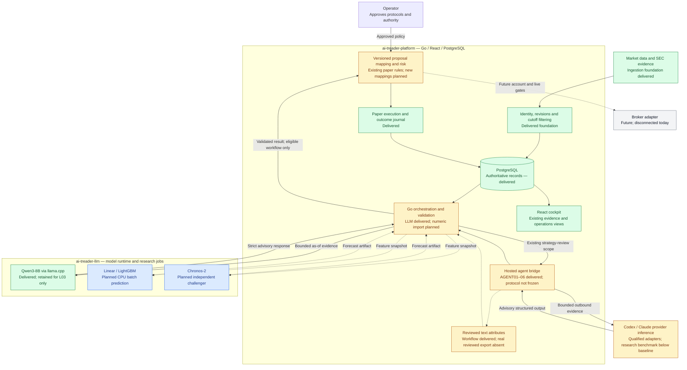
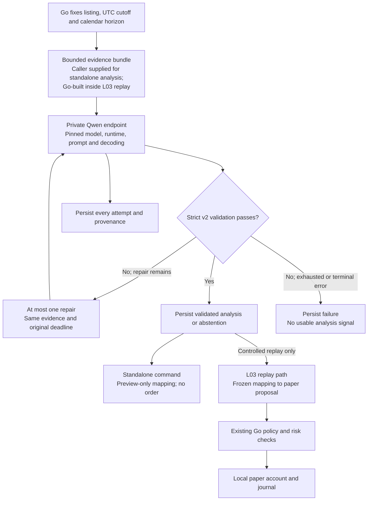
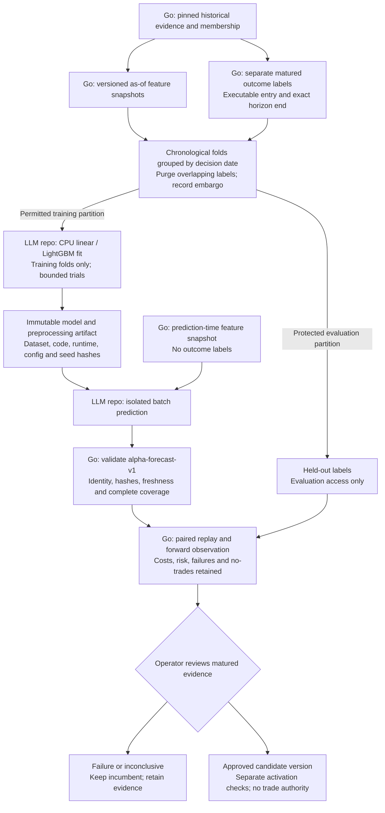
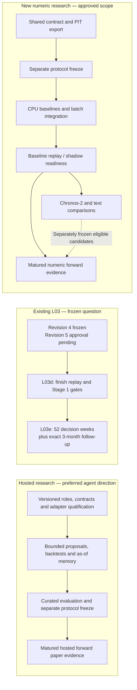
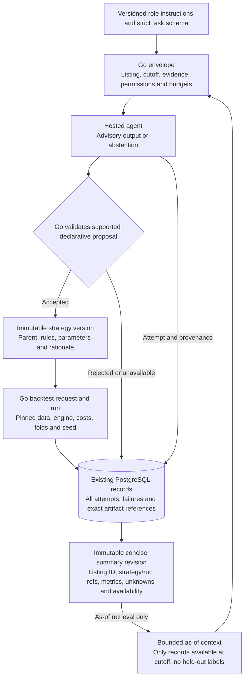
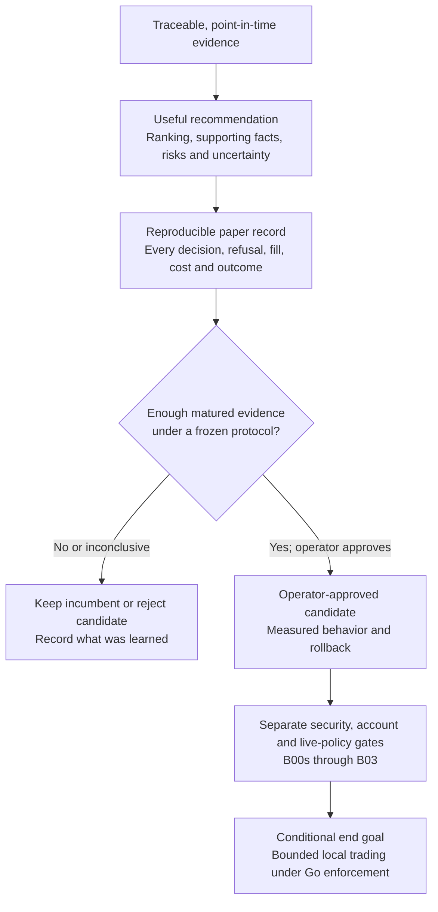

# AI-Treader architecture

Architecture and delivery snapshot — **2026-10-22**.

We are building a local, personal research and trading system that turns traceable
evidence into recommendations, measures those recommendations in paper trading,
and can eventually operate within separately approved live limits.

**Today:** the platform foundation, hosted research contracts, bounded proposal loop,
provider-neutral text-capture workflow, concise as-of research summaries and hosted
evaluation harness are delivered. The live hosted benchmark did not beat the
do-nothing baseline, so no hosted forward protocol is frozen. The local Qwen endpoint
is retained only for the existing L03 experiment, whose evaluation is unfinished.
Numeric v1 contracts, Python/Go conformance and platform PIT feature/label export are
delivered; the frozen protocol and prediction models remain planned. No broker is connected and no live trading is
authorized.

This document is a visual explanation, not another backlog. Current task state and
order remain in the [LLM backlog](tasks/BACKLOG.csv) and
[platform backlog](../ai-treader-platform/tasks/BACKLOG.csv). Task IDs below are
qualified by repository because both repositories use ALPHA IDs.

## 1. What does what

The **platform controls the system**, the **models supply evidence or predictions**,
and the **operator approves experiments and authority**.

| Component | Responsibility | Runs where | Delivery state |
|---|---|---|---|
| React cockpit | Show recommendations, evidence, operations and outcomes | Platform UI in the browser | Existing surfaces delivered; new numeric views not implemented |
| Go backend | Ingest data, select information available at a cutoff, calculate financial features, orchestrate jobs, validate results and enforce policy/risk | Existing platform deployment | Foundation, numeric validation and PIT export delivered; batch prediction integration planned |
| PostgreSQL | Authoritative identities, source revisions, datasets, runs, decisions, paper ledger and outcomes | Existing platform database | Delivered, including immutable numeric export records; prediction records planned |
| Hosted agent bridge | Bounded listing analysis, declarative proposals, reviewed text attributes and as-of research summaries | Platform CLI adapters; inference at the provider | AGENT01–06 delivered; no forward protocol frozen |
| Qwen3-8B / llama.cpp | Retained existing L03 analysis only | Pinned Docker inference on Ubuntu / RTX 3080 | Endpoint and Go integration delivered; no new local general-LLM branch |
| Linear model / LightGBM | Learn numeric relationships and produce relative-return scores | Planned isolated CPU batch jobs owned by LLM repository | Not started |
| Chronos-2 | Challenge the numeric baseline with pretrained time-series forecasts | Planned local batch job; CPU/GPU placement measured before use | Not started |
| Reviewed text attributes | Extract cited guidance, liquidity and event attributes; evaluate accuracy and numeric usefulness | Platform hosted captures; LLM repository offline evaluation | Workflow delivered; real reviewed capture/export and LLM evaluation still absent |
| Contract validators | Reject malformed, out-of-scope or mismatched results | Python in LLM repository; Go in platform | Analysis v2 and numeric v1 cross-language conformance delivered |
| Paper engine and journal | Simulate orders, enforce risk, record fills/costs/holdings and mature outcomes | Go and PostgreSQL | Delivered; comparative evaluation unfinished |
| Host dashboard | Report sanitized hardware and endpoint health | Restricted native service on Ubuntu | Delivered; future-job telemetry remains unavailable |
| Broker adapter | Reconcile accounts and eventually submit authorized orders | Future Go integration | Not started; separate security and approval gates |

## 2. Whole-system view

**Legend:** green = delivered foundation; amber = built but qualification/evaluation
unfinished; blue = approved planned extension; gray = future conditional capability.
Each node also states its status so color is not required. Arrows show information
flow or authority, not proof that every connected path is implemented.

Models have no broker credentials or database write authority. Go computes financial
values, checks limits and owns execution. The standalone local-analysis command is
preview-only; paper proposals are produced by the separately controlled replay path.
Combining numeric scores and LLM evidence is a future experiment, not an automatic
rule in this diagram.

## 3. Retained local LLM / L03 path

Schema and citation checks establish structural validity, not the truth of prose
or numerical claims. The live endpoint smoke and endpoint benchmark do not prove
predictive value. L03 Stage 1 is incomplete: revision 4 encountered reply truncation;
revision 5 proposes 8192 context / 2048 output tokens and still needs separate approval.
The newer host configuration needs CTX01 qualification beyond the earlier benchmark.

The hosted research workflow is a separate advisory path. AGENT01–06 implement
bounded listing analysis, strategy proposals, text capture, as-of summaries and
evaluation without changing this frozen L03 path. AGENT07 remains conditional on an
operator-frozen protocol and actual elapsed forward evidence.

## 4. Planned numeric learning and prediction

Training and prediction use separate inputs. Numeric supervised fitting needs
historical training labels; prediction jobs and LLM prompts must never receive them.

All components in this new numeric path require implementation, although they reuse
existing platform infrastructure. Start with daily features, a **one-calendar-month
target and weekly decisions**; evaluate 3m separately. Product scope remains 1–6 month
holdings. A forecast horizon does not itself force liquidation.

After baseline replay readiness, evaluate Chronos-2 and reviewed text attributes as
separate challengers. Compare numeric-only against numeric-plus-text on the same
folds and mechanics. A ranking score is not a probability; model quantiles need
calibration checks. A combined model is considered only after incremental evidence.

## 5. Where we stand

| Capability | Current position | Remaining work / owner |
|---|---|---|
| Data and paper foundation | Identity, revisions, PIT machinery, policy/risk, ledger and journal delivered | Real training coverage and historical universe evidence still needed |
| Hosted agents | AGENT01–06 delivered; live benchmark below do-nothing baseline | Operator protocol decision and, only after a freeze, AGENT07 forward evidence |
| Concise research history | Immutable linked summaries and bounded as-of retrieval delivered | Use only under a frozen hosted protocol; no vector-memory service |
| Local LLM | Endpoint, Go client, strict analysis and attempt persistence delivered | Existing L03 only; CTX01 is conditional on revision-5 approval |
| Reviewed datasets | LLM DATA01 source receipt and target plan delivered | Platform ALPHA02 numeric export |
| Existing L03 experiment | Replay/evaluator built; Stage 1 unfinished | Platform L03d revision-5 approval and run; L03e forward observation |
| Numeric contracts and models | Contracts, cross-language conformance and platform PIT numeric export delivered; no model | Operator/platform ALPHA03, LLM ALPHA02, then platform ALPHA04–05 |
| Chronos-2 and text attributes | Planned | LLM ALPHA03 / TEXT01; platform ALPHA06 / ALPHA07 |
| Combined challenger | Conditional decision only | Platform ALPHA08; implement only through subsequent bounded tasks |
| Numeric forward evidence | Not started | Platform ALPHA09; actual elapsed time and matured outcomes required |
| Retired local general-LLM branch | Standalone tool-suite qualification, RAG, QLoRA, adapter export and local-model promotion are not part of the approved path | Reintroduce only through a new explicit architecture decision and measured need |
| Broker and bounded live operation | No connection or authorization | Platform B00s–B03; independent account, security and operator gates |

The existing 13-listing L03 universe and survivorship-biased pilot/sizing universe
can test plumbing; they do not establish broad stock-selection performance.
Historical reconstruction assumptions and pretrained hindsight remain explicit.
L03's power analysis indicates that its forward result is expected to be inconclusive;
it cannot establish a general profitability claim.

The three evaluation tracks remain separate:

Hosted and numeric implementation do not depend on completing L03e. They must preserve L03's protected
evaluation windows. These arrows summarize milestones; exact dependencies and
serial work order are owned by the two backlogs, not this diagram.

## 6. Deployment and resource boundaries

| Location | Existing | Planned |
|---|---|---|
| Mac development environment | Repository work and CPU checks; no GPU dependency environment | Isolated CPU numeric development and validation |
| Platform deployment | Go backend, React cockpit, PostgreSQL and worker infrastructure | Batch orchestration/import and numeric evaluation; same infrastructure |
| Ubuntu AI host | RTX 3080, pinned Qwen Docker inference, private access and read-only dashboard | Optional measured Chronos jobs on the same fixed GPU with exclusive scheduling |
| Hosted provider | Qualified Codex/Claude adapters and bounded research tasks; inference outside the local machine | A separately frozen forward protocol only if evidence justifies one |
| Artifact storage | Versioned model files and manifests; generated artifacts outside Git | Hashed numeric datasets, trained models and evaluation reports |

Local operation does not make hosted inference local: scoped evidence is sent to the
selected provider. Keep credentials and unnecessary private records out of envelopes.
Use the existing CPU environment for baselines. Chronos-2 starts on CPU and may use
the existing RTX 3080 only after measurement; no larger GPU purchase is in scope.

No additional always-on model gateway, queue, vector service or experiment database
is planned. CPU baselines come first. Hardware qualification is unfinished; 64 GiB
RAM is a design target, not a verified installed capacity. Do not assume Qwen and a
second GPU model can run concurrently. Current Linux storage is restricted to the
permitted disk; Windows NVMe devices remain out of scope.

## 7. Planned call instructions, versions and reusable history

Use reusable versioned role instructions, not a newly invented prompt for each call.
Go builds the variable envelope with exact listing identity, UTC cutoff, allowed
source references, strategy version, engine capabilities, trial budget and schema.
Persist the rendered prompt hash and configured/observed provider identity. Preserve
unknown values and refusals. Hosted model weights may not be reproducible even when
the captured request is exact.

An agent proposes; Go allocates strategy versions, validates backtest specifications,
runs supported engines and writes records. A retry is not a new independent trial;
intentional repeated trials remain visible against the campaign budget. Changed
rules, parameters, features or compiler semantics require a new strategy version.

Concise history is keyed by stable listing identity, with ticker history preserved;
cross-sectional strategies also retain their universe snapshot. Summaries link exact
runs, units, windows and evidence rather than replacing underlying records. A summary
written later cannot enter an earlier simulated decision merely because it describes
old data. Outcome maturity and protected evaluation partitions remain enforced.

See the [platform implementation plan](../ai-treader-platform/tasks/PLAN.md#hosted-agents-call-instructions-and-research-records-approved-2026-10-07)
for the canonical envelopes and record fields. No new database or vector service is
required by this design. Platform ALPHA01–02 are complete; the current cross-repository
critical path is operator/platform ALPHA03, followed by LLM ALPHA02 and platform ALPHA04.
HARD01 can proceed in parallel and does not unblock that numeric path.

## 8. What we want to accomplish

Success means recommendations we can inspect and reproduce, a measured paper record,
and a system that keeps the incumbent when a challenger fails. The eventual trading
module may operate under a bounded standing policy, but only the Go backend can
enforce that policy and authorize execution. The proposed approximately USD 1,000
live allocation is a future separately approved scope, not funded or enabled here.

The learning loop creates reviewed dataset, model and policy versions. It does not
let a model rewrite live limits, increase budgets or promote itself. Local personal
use is recorded; source/license metadata and unknown permissions remain explicit.

## References and maintenance

- [LLM status](STATUS.md) and [LLM backlog](tasks/BACKLOG.csv).
- [Platform status](../ai-treader-platform/STATUS.md),
  [platform backlog](../ai-treader-platform/tasks/BACKLOG.csv) and
  [approved product plan](../ai-treader-platform/tasks/PLAN.md).
- [LLM implementation plan](docs/IMPLEMENTATION_PLAN.md),
  [contract and code boundaries](docs/CODE_DESIGN.md), and [runbook](docs/RUNBOOK.md).

Update this snapshot when architecture or delivered capabilities change. Backlog
acceptance evidence remains authoritative; a diagram is not implementation proof.
